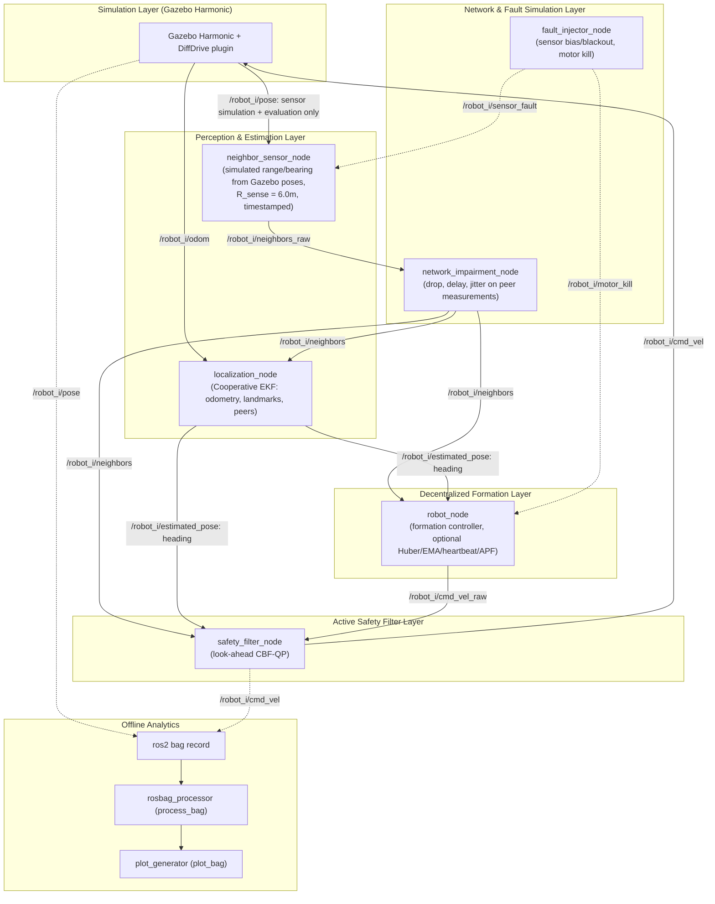

# Physics-Verified Decentralized Multi-Robot Formation Control Under Relative Sensing, Asymmetric Network Impairments, and Control Barrier Function Safety Layer

[](https://docs.ros.org/en/jazzy/)
[](https://gazebosim.org/docs/harmonic)
[](https://ubuntu.com/)
[](LICENSE)
[-blue.svg)](src/swarm_formation/test)
[](Dockerfile)

> **Author**: Mansoor Ahmed Rind  
> **Affiliation**: Department of Robotics & Artificial Intelligence, National University of Sciences and Technology (NUST), Islamabad, Pakistan  
> **Workspace**: `~/swarm_ws` | **Package**: `swarm_formation`

---

## 1. Project Overview & Scientific Highlights

This repository delivers a ROS 2 / Gazebo robotics software framework for **decentralized multi-robot geometric formation control** in GPS-denied, obstacle-strewn disaster environments (modeled after an urban structural collapse). 

A swarm of **5 nonholonomic differential-drive mobile robots** autonomously self-organizes into a regular pentagon ($R = 2.0\,\text{m}$) without any central coordinator, global GPS/mocap positioning, or designated leader.

> **Validation status (2026-11-07):** in Gazebo, ten repeated runs of the default configuration from perturbed start poses (Section 6.1) all reached the formation without collisions: on a clean channel in 7.0 s to a 0.048 m final shape error (threshold 0.25 m), after which the robots stand still; under the launch file's fault settings (15% drop, 80 +/- 40 ms delay, robot 4 motors off for 5 s) in 11.5 s to 0.15 m, with the error wobbling between about 0.1 and 0.3 m (worst 0.5 m). All three controller families converge in the deployed arena stack (Section 4.4); localization weights neighbours by their shared covariance (Section 6.3). Statistics (Sections 4.4, 6, 6.3) come from a headless kinematic simulator that mirrors the ROS node pipeline. All Gazebo results before 2026-11-07 ran without wheel odometry (a bridge type mismatch) and are superseded.

```
                Robot 2 (0.62, 1.90)
                   *
                 /    \
Robot 3        /        \
(-1.62, 1.18) *          \
              |           * Robot 1 (2.00, 0.00)
(-1.62,-1.18) *          /
Robot 4        \        /
                 \    /
                   *
                Robot 5 (0.62, -1.90)

Target slot of robot k: angle 72 deg * (k - 1), counter-clockwise from +x
(see consensus.compute_target_offsets). Only relative offsets are controlled,
so the whole pentagon may be translated.
```

### Key Engineering & Scientific Capabilities:
1. **Decentralized Relative Polar Sensing**: No robot reads global $(x, y)$. Sensing is restricted to onboard relative polar range and bearing within $R_{\text{sense}} = 6.0\,\text{m}$.
2. **Three Interchangeable Controller Families**:
   - **Displacement-based consensus** with Huber robust penalty (Ren & Beard 2008).
   - **Distance-based control with signed-area constraints** (Krick et al. 2009; Anderson et al. 2017): no common heading needed.
   - **Bearing-only control** with orthogonal projection (Zhao & Zelazo 2016) plus a weak range term for the scale.
   All three converge from the Gazebo spawn and in the deployed arena stack (Section 4.4).
3. **Cooperative EKF Localization Law**: An onboard Extended Kalman Filter fuses wheel odometry, known landmarks and relative neighbour measurements; each neighbour's estimate is weighted by its shared covariance (`/robot_i/estimated_pose_cov`), which keeps the filter consistent (NEES ~2 instead of >10). Without the landmark map (`use_landmarks:=false`) the absolute pose drifts (0.8 m), while formation control, which uses relative measurements, still converges (Section 6.3). Ground truth is strictly isolated for offline metric evaluation.
4. **Active Safety Layer (CBF-QP)**: A standalone look-ahead Control Barrier Function QP filter (exact 2D solver, exact unicycle mapping, right-hand deadlock breaking). In the kinematic campaign it kept every run collision-free ($d_{\min} \ge 0.50\,\text{m}$) **while still reaching the formation in 100% of clean-channel runs** (see Section 6).
5. **Delay-Compensated Safety**: Barrier expansion $D_s^{\text{eff}} = D_s + \ell + 2 v_{\max} \tau_{\max}$ plus delay compensation (each delayed measurement is corrected by the robot's own motion). With latency actually applied to every peer measurement, all runs stayed collision-free up to 200 ms; formation accuracy is unaffected up to 100 ms (0.044 m) and degrades at 200 ms (0.135 m).
6. **Decoupled Network Impairments & Fault Injection**: Standalone nodes simulate Bernoulli packet loss, stochastic delay queues, sensor bias, and agent dropouts, with runtime ROS 2 service toggles.
7. **Offline Rosbag-Driven Analytics**: Rosbag recording (`ros2 bag`), offline Procrustes metric extraction (`process_bag`), and publication plot generation (`plot_bag`).
8. **Statistical Rigor & One-Command Replication**: 425-run kinematic campaign on the deployed stack in the arena (25 seeds $\times$ 17 conditions, leave-one-out ablation, applied packet-drop and latency sweeps, robot dropout) with Student's $t$ 95% Confidence Intervals, reproducible via `./reproduce_all.sh`. The campaign uses a headless unicycle simulator that mirrors the ROS node pipeline; it is not a physics simulation.

---

## 2. System Architecture

The software architecture is modularized into decoupled ROS 2 nodes and pure Python algorithmic libraries:

### 2.1 Component Flow Diagram



---

## 3. Node, Topic, Service & Parameter Reference

### 3.1 Node Summary

| Node Name | Executable | Description |
| :--- | :--- | :--- |
| `neighbor_sensor_i` | `neighbor_sensor` | Measures relative range and bearing to peers within $R_{\text{sense}}$. Strictly relative polar. |
| `localization_node_i` | `localization_node` | Cooperative EKF state estimator fusing odometry and neighbor bearings. |
| `gazebo_node_i` | `robot_node` | Formation controller executing displacement, distance, or bearing control law. |
| `safety_filter_i` | `safety_filter` | Standalone Control Barrier Function QP filter outputting safe unicycle velocity commands. |
| `network_impairment` | `network_impairment` | Central wireless degradation node simulating packet drop, delay, jitter, and link toggles. |
| `fault_injector` | `fault_injector` | Injects deterministic or stochastic faults (agent kill, sensor bias, intermittent dropouts). |
| `swarm_metrics_logger` | `metrics_logger` | Continuous online ground-truth logger writing `swarm_metrics.csv` for run monitoring. |

### 3.2 Topic Interfaces

| Topic Name | Message Type | Direction | Description |
| :--- | :--- | :--- | :--- |
| `/robot_{i}/odom` | `nav_msgs/msg/Odometry` | Subscribed | Raw wheel odometry from differential drive base. |
| `/robot_{i}/relative_neighbors` | `swarm_interfaces/msg/RelativeNeighborList` | Published | Ego-centric relative polar measurements $(r, \phi)$ of visible peers. |
| `/robot_{i}/estimated_pose` | `geometry_msgs/msg/PoseStamped` | Published | Cooperative EKF estimated pose $(\hat{x}, \hat{y}, \hat{\theta})$ in local frame. |
| `/robot_{i}/neighbors` | `swarm_interfaces/msg/NeighborList` | Subscribed | Degraded neighbor state packets received after network impairment simulation. |
| `/robot_{i}/cmd_vel_raw` | `geometry_msgs/msg/Twist` | Published | Unconstrained formation control twist before safety filtering. |
| `/robot_{i}/cmd_vel` | `geometry_msgs/msg/Twist` | Published | Certified safe twist output by CBF-QP filter sent to robot actuator. |
| `/robot_{i}/safety_intervention` | `std_msgs/msg/Bool` | Published | Flag indicating active CBF barrier deflection ($u_{\text{safe}} \neq u_{\text{raw}}$). |
| `/swarm/network_status` | `std_msgs/msg/String` | Published | Real-time diagnostic telemetry of dropped packets, latency, and active links. |
| `/swarm/fault_status` | `std_msgs/msg/String` | Published | Active fault injection scenario and affected agent IDs. |

### 3.3 Service Interfaces

| Service Name | Service Type | Description |
| :--- | :--- | :--- |
| `/network/toggle_link` | `swarm_interfaces/srv/ToggleLink` | Dynamically enables or disables a directed wireless link $(i \to j)$ at runtime. |
| `/faults/trigger` | `swarm_interfaces/srv/TriggerFault` | Triggers immediate agent death, sensor bias, or dropout via programmatic ROS 2 call. |

### 3.4 Launch Arguments (`gazebo_swarm_launch.py`)

| Argument | Default | Type | Description |
| :--- | :---: | :---: | :--- |
| `controller_type` | `displacement` | `string` | Formation controller family: `displacement`, `distance`, `bearing`. |
| `use_safety_filter` | `true` | `bool` | Enables standalone CBF-QP minimal-correction safety filter. |
| `use_resilient_method`| `false` | `bool` | Enables Huber gradient thresholding and EMA smoothing. |
| `enable_faults` | `false` | `bool` | Enables 15% packet drop, 80 ms latency, and agent-4 dropout. |
| `formation_radius` | `2.0` | `float` | Target pentagon radius in meters ($R$). |
| `sensing_range` | `6.0` | `float` | Onboard sensor range limit in meters ($R_{\text{sense}}$). |
| `record_bag` | `false` | `bool` | Enables automated recording of swarm topics with `ros2 bag`. |
| `bag_path` | `""` | `string` | Destination directory path for recorded rosbag. |
| `headless` | `true` | `bool` | Runs Gazebo Harmonic in headless server mode. |
| `sim_duration` | `0.0` | `float` | Auto-shutdown duration in seconds (`0.0` = manual Ctrl-C). |
| `world` | `collapsed_building.sdf` | `string` | World environment path. |
| `use_landmarks` | `true` | `bool` | EKF uses the known landmark map (`false` = odometry + peers only). |
| `use_peer_covariance` | `true` | `bool` | EKF weights peer estimates by their shared covariance. |

---

## 4. Theory of the Three Controller Families

All three implement `SwarmControllerBase.compute_control_force` (`controllers.py`), take only
relative measurements $p_{ij} = p_j - p_i$ of the neighbours, and are selected with the
`controller_type` launch argument. Robot $i$'s target slot is vertex $i$ of the pentagon, so
$p_{ij}^* = c_j - c_i$, $d_{ij}^* = \|p_{ij}^*\|$ and $g_{ij}^* = p_{ij}^*/d_{ij}^*$; $\mathrm{sat}$
clips an error to $\pm\delta$ (Huber).

### 4.1 Displacement-Based Consensus (Ren & Beard 2008)
$$u_i = k \sum_j \mathrm{sat}_\delta\big(p_{ij} - p_{ij}^*\big)$$
Linear, globally convergent; needs a common heading (the offsets are expressed in a shared frame).

### 4.2 Distance-Based Control with Signed-Area Constraints (Krick et al. 2009; Anderson et al. 2017)
$$u_i = k \Big[\sum_j \mathrm{sat}\big(\|p_{ij}\| - d_{ij}^*\big)\frac{p_{ij}}{\|p_{ij}\|} \;-\; a\!\!\sum_{j<k}\mathrm{sat}\big(A_{ijk} - A_{ijk}^*\big)\,\nabla_{p_i}A_{ijk}\Big],
\qquad A_{ijk} = \tfrac12\, p_{ij}\times p_{ik}$$
Both terms are invariant to a rotation of the robot's measurement frame (tested), so **no
common heading is needed**. The distance term alone (Krick et al.) is only locally
convergent and cannot tell the pentagon from its mirror image: from the Gazebo spawn, whose
robot order is scrambled relative to the pentagon, it stalls at 2.68 m, and it reached the
exact pentagon from only 20 of 100 random starts (39 up to reflection). The signed areas ($a = 0.5$) fix the orientation and
remove those equilibria: 0.000 m from the Gazebo spawn and from 100/100 random starts
(`test_m4_acceptance.py`). Set `area_gain=0` for the pure law.

### 4.3 Bearing-Only Control with a Scale Term (Zhao & Zelazo 2016)
$$u_i = k \sum_j \Big[-d_{ij}^*\,P(g_{ij})\,g_{ij}^* \;+\; s\,\mathrm{sat}\big(\|p_{ij}\| - d_{ij}^*\big)\,g_{ij}\Big],
\qquad g_{ij} = \frac{p_{ij}}{\|p_{ij}\|},\; P(g) = I - g g^\top$$
The first term is the bearing-only law; it reaches the target bearings up to translation and
scale. A bearing-only law keeps the initial scale, so a weak range term ($s = 0.5$) sets the
size. Bearings are world-frame directions, so like 4.1 it needs a common heading.

### 4.4 Validation of the three families
Kinematic study (single integrators, all 5 robots measured): every family converges to
< 0.05 m from the Gazebo spawn and from 100/100 random starts in an 8 m square. Deployed
stack in the arena (CBF, navigation, anchor, calm mapper, delay compensation), 25 seeds per
cell, campaign simulator:

| Controller | Channel | Converged | Collision-free (robots + obstacles) | Final shape error, median (max) | Closest robots |
| :--- | :--- | :---: | :---: | :---: | :---: |
| displacement | clean | 25/25 | 25/25 | 0.047 m (0.066) | 0.91 m |
| displacement | impaired | 25/25 | 25/25 | 0.032 m (0.053) | 0.86 m |
| distance + area | clean | 23/25 | 25/25 | 0.052 m (1.81) | 0.77 m |
| distance + area | impaired | 23/25 | 25/25 | 0.053 m (0.98) | 0.68 m |
| bearing | clean | 25/25 | 25/25 | 0.073 m (0.110) | 0.81 m |
| bearing | impaired | 24/25 | 25/25 | 0.046 m (0.78) | 0.84 m |

All 150 runs are collision-free. The distance controller's failures are deadlocks, not
divergence: its formation may settle in any orientation, and in 2 of 25 runs per channel
the orientation it picked from the scrambled spawn required two robots to swap sides of a
rubble block through a narrow gap, where the CBF holds them (they stop, safe, at ~1.8 m
error). Before the anchor and the navigation target followed the formation's own
orientation, 7 of 50 runs failed this way.

The navigation layer routes each robot toward its slot, found by fitting the formation
template to the measured neighbours (`navigation.formation_target`); for the distance
controller the fit includes a rotation, and the anchor uses the same fitted orientation, so
it fixes only the formation's position (`fit_template_rotation`).

---

## 5. Control Barrier Function (CBF-QP) Safety Layer

### 5.1 Look-Ahead Formulation for Unicycles
A unicycle cannot move sideways, so a barrier written for a single integrator ($\dot p_i = u_i$) stops holding once its output is converted back to $(v, \omega)$. The filter therefore works on the look-ahead point $q_i = p_i + \ell\,[\cos\psi_i,\ \sin\psi_i]^T$ ($\ell = 0.15\,\text{m}$), whose velocity is fully actuated:
$$\dot q_i = R(\psi_i)\,\mathrm{diag}(1, \ell)\,[v_i,\ \omega_i]^T$$
For each neighbor $j$, with $D^{\text{eff}} = D_s + \ell + 2 v_{\max} \tau_{\max}$ and $D_s = 0.55\,\text{m}$:
$$h_{ij} = \|p_j - q_i\|^2 - (D^{\text{eff}})^2, \qquad (p_j - q_i)^T \dot q_i \le \tfrac{\gamma}{4}\, h_{ij}$$
Keeping $\|p_j - q_i\| \ge D_s + \ell$ implies $\|p_j - p_i\| \ge D_s$ for the robot centers. At each 50 Hz step the robot solves
$$\min_{u} \tfrac12 \|u - \dot q_i^{\text{nom}}\|^2 \quad \text{s.t.}\quad A_k u \le b_k\ \ \forall k,\quad \|u\| \le v_{\max}$$
exactly (2D active-set enumeration, including the speed-circle intersections), and maps $u$ back to $(v, \omega)$ with the exact inverse. The inequality the QP enforces is therefore the one the robot actually executes.

### 5.2 Deadlock Breaking
Symmetric multi-robot CBF filters are known to deadlock: in the original implementation the clean-channel CBF stack reached the formation in only 36% of runs (12% for the full stack). When the nominal command pushes into a barrier, the filter now adds a tangential component (every robot veers to its right, like a roundabout). This changes only the *nominal* input, so the barrier constraint is unaffected.

### 5.3 What Is and Is Not Guaranteed
- The barrier is enforced on the *estimated* relative positions. Estimation error, measurement noise and latency beyond $\tau_{\max}$ are not covered, so collision avoidance is reported as **empirical**, not certified.
- The reciprocal split ($\gamma/4$) assumes neighbors run the same filter.
- Safety under delay relies on the margin $2 v_{\max}\tau_{\max}$; the campaign checks this with the delay actually applied to every peer measurement.

---

## 6. Statistical Campaign (425 Runs)

Headless kinematic simulator (`campaign_simulator.py`) that mirrors the ROS node pipeline: real `RobotEKF`, the same controller, navigation and CBF code as the nodes, and drop, delay and jitter actually applied to every peer measurement. Crossing initial conditions in the arena of `collapsed_building.sdf`, 30 s per run, 25 seeds per condition. "Reached formation" = shape error below 0.25 m for 2 s. Contact with obstacles is not simulated, only measured. Reproduce with `ros2 run swarm_formation run_campaign --workers 6` (about 8 min on 8 cores).

| Condition | Reached formation | Final shape error (m), mean [95% CI] | Robot-robot: collision-free / worst distance | Robot-obstacle: collision-free | Settled turn rate | Path length (m) |
| :--- | :---: | :---: | :---: | :---: | :---: | :---: |
| No avoidance (clean) | 100% | 0.042 [0.037, 0.047] | 0% / 0.15 m | 76% | 0.00 rad/s | 22.9 |
| APF instead of CBF (clean) | 100% | 0.044 [0.038, 0.049] | 0% / 0.06 m | 80% | 0.00 rad/s | 22.6 |
| **Deployed stack (clean)** | 100% | 0.047 [0.044, 0.050] | 100% / 0.91 m | 100% | 0.00 rad/s | 23.4 |
| **Deployed stack, impaired** | 100% | 0.035 [0.029, 0.042] | 100% / 0.76 m | 100% | 0.23 rad/s | 26.1 |
|   without navigation, impaired | 80% | 0.220 [0.066, 0.373] | 100% / 0.64 m | 100% | 0.48 rad/s | 26.9 |
|   without anchor, impaired | 100% | 0.035 [0.030, 0.040] | 100% / 0.86 m | 100% | 0.25 rad/s | 25.5 |
|   without delay compensation, impaired | 100% | 0.049 [0.038, 0.060] | 100% / 0.81 m | 100% | 0.54 rad/s | 32.2 |
|   legacy twist mapper, impaired | 100% | 0.071 [0.061, 0.081] | 100% / 0.84 m | 100% | 2.63 rad/s | 38.5 |
|   + Huber/EMA/heartbeat, impaired | 100% | 0.035 [0.030, 0.040] | 100% / 0.80 m | 100% | 0.03 rad/s | 26.3 |
| 15% packet drop | 100% | 0.047 [0.044, 0.049] | 100% / 0.91 m | 100% | 0.00 rad/s | 23.2 |
| 30% packet drop | 100% | 0.048 [0.045, 0.052] | 100% / 0.83 m | 100% | 0.00 rad/s | 23.1 |
| 50% packet drop | 100% | 0.045 [0.042, 0.049] | 100% / 0.84 m | 100% | 0.01 rad/s | 23.2 |
| 50 ms delay | 100% | 0.048 [0.045, 0.050] | 100% / 0.88 m | 100% | 0.00 rad/s | 22.7 |
| 100 ms delay | 100% | 0.044 [0.040, 0.047] | 100% / 0.75 m | 100% | 0.00 rad/s | 23.3 |
| 200 ms delay | 100% | 0.135 [0.120, 0.150] | 100% / 0.75 m | 100% | 1.88 rad/s | 38.6 |
| 200 ms delay, CBF bound matched to 200 ms | 44% | 0.379 [0.256, 0.501] | 100% / 1.12 m | 100% | 1.69 rad/s | 53.3 |
| Robot 4 stops for good at 5 s | 84% | 0.223 [0.209, 0.237] | 100% / 0.85 m | 100% | 0.24 rad/s | 25.4 |

*Campaign re-run on 2026-11-07 on the deployed stack: every condition runs in the arena (obstacles, walls) with navigation, the anchor, the calm twist mapper, delay compensation and the 50 ms CBF delay bound, unless it varies one of them. "Impaired" = the launch file's fault settings (15% drop, 80 ± 40 ms delay) plus range/bearing noise (0.05 m / 0.02 rad).*

**What the data supports:**
- **Safety:** the deployed stack never collided in any of its 375 runs (15 conditions): robots stayed at least 0.64 m apart and never touched an obstacle or wall. Without avoidance every run had a robot-robot collision and 24% hit an obstacle.
- **APF is not a substitute in the arena.** With navigation, APF collided in every run: navigation replaces the force direction while a route is blocked, which also discards APF's repulsion. Without navigation (checked separately, 4 seeds), APF kept robots apart but hit obstacles in every run, because its campaign implementation only repels other robots. The CBF acts after navigation, so the deployed stack is unaffected.
- **Accuracy:** the deployed stack converges in every run, clean (0.047 m) and impaired (0.035 m), and is unaffected by packet loss up to 50% and delay up to 100 ms (0.044-0.048 m).
- **What matters in the ablation:** removing **navigation** hurts most (80% converge, 0.220 m): robots get trapped behind obstacles. The **legacy twist mapper** doubles the error (0.071 m) and spins at 2.63 rad/s once settled (0.23 with the calm mapper). Removing **delay compensation** costs a little (0.049 m, 23% longer paths, more turning). The **anchor** makes no difference here (0.035 m without it); its job is to stop the drift that pinned robots on the wall in Gazebo. Adding the old **Huber/EMA/heartbeat** layer is neutral (0.035 m).
- **200 ms delay** is where accuracy breaks down (0.135 m, settled turning 1.88 rad/s), though safety holds even with the CBF bound left at 50 ms (worst distance 0.75 m). **Matching the bound to 200 ms makes things worse in the arena** (44% converge, 0.379 m): the larger margins close gaps between obstacles. A tight bound plus delay compensation is the better trade here.
- **Permanent robot failure:** when robot 4 stops at 5 s, 84% of runs still reach the formation with the other robots placed around it (0.223 m). Nothing in the stack reassigns the lost robot's slot.

### Campaign Figures
Generated from `campaign_results.json` into `results/M8/plots/`:
1. `ablation_study_barchart.png`: leave-one-out ablation of the deployed stack under nominal impairment.
2. `safety_comparison_apf_vs_cbf.png`: minimum robot-robot distance in the arena (no avoidance, APF, deployed CBF).
3. `difficulty_sweep_packet_drop.png`: packet drop sweep (0-50%).
4. `difficulty_sweep_latency.png`: applied latency sweep (0-200 ms), deployed 50 ms bound vs matched bound.

> The M8 numbers published before 2026-11-07 (325 runs, "47.2% energy reduction", "safe under 200 ms") came from a simulator that did not apply delay and from CBF runs that deadlocked. They are superseded; see the erratum in `reports/TECHNICAL_REPORT.md`.

---

### 6.1 Gazebo Validation (Phase C)

All runs: 5 robots, crossing start positions, CBF on, clean channel, 40 s of simulated
time, ROS 2 Jazzy + Gazebo Harmonic in WSL2 (Ubuntu 24.04, 4 cores). Raw CSVs and launch
logs are in `results/phaseC/`.

| Run | Change | Final shape error | Closest robots | What happened |
| :--- | :--- | :---: | :---: | :--- |
| `cbf_clean` | nodes on wall clock (old default) | 2.49 m | 1.13 m | Gazebo ran at ~5% of real time; controllers saw huge lag and robots crawled |
| `cbf_simtime` | `use_sim_time:=true` | 0.59 m | 0.83 m | formation formed (0.32 m at ~25 s), then drifted and pinned robots on the east wall |
| `cbf_walls` | walls sensed, true obstacle sizes | 2.43 m | 0.72 m | no wall contact, but robots 2 and 5 trapped between rubble pieces |
| `cbf_boxes` | exact box shapes, 0.10 m obstacle margin | 1.37 m | 0.83 m | robot 2 freed; robot 5 still trapped at a 0.66 m gap the CBF cannot pass |
| `cbf_nav` | navigation layer | 0.46 m | 0.96 m | every robot moves and reaches the formation area; error hovers 0.30 to 0.46 m against the east wall |
| `cbf_nav_anchor` | + anchor at the spawn centroid | 1.61 m | 0.75 m | not converged; formation centre held within 0.28 m of target, but robots 2 and 5 froze near their old trap spots from ~5 s; mean localization error 0.18 m (vs 0.10 m in `cbf_nav`) |
| `diag_anchor` | same as `cbf_nav_anchor`, with rosbag | 0.66 m | 0.96 m | converged at 18.8 s; max error over last 10 s 0.66 m; mean localization error 0.075 m. The bag showed `/robot_i/odom` had **0 messages** and heading errors of 0.1 to 0.4 rad |
| `diag_anchor_odom` | wheel odometry fixed (bridge type + EKF fallback) | 0.10 m | 0.91 m | converged at 13.0 s; max error over last 10 s 0.18 m; mean localization error 0.015 m |
| `cbf_final_default` | anchor + navigation (no bag) | 0.06 m | 0.88 m | converged at 13.7 s; max error over last 10 s 0.49 m; mean localization error 0.014 m. The formation first assembled ~1.6 m from the anchor point; from ~22 to 35 s the anchor dragged it past the two slabs, which held robots 1 and 2 back and stretched the shape to 0.49 m, before it settled at its target |
| `diag_calm` | + calm twist mapper (force-scaled turning, stop band) | 0.52 m | 0.92 m | converged at 12.0 s; settled robots stopped turning (0.00 rad/s), but from ~30 s robots 1 and 2 were frozen: their force pointed behind them, the controller asked to turn in place, and the look-ahead CBF cancelled the rotation |
| `diag_calm2` | + pure rotation passes the CBF | 0.08 m | 0.87 m | converged at 22.8 s; no freezing; robot 1 was blocked head-on by the CBF for ~15 s while following a navigation route; the anchor stayed saturated (formation ~1 m off its anchor point), so residual forces kept some robots turning |
| `diag_clearance` | planner clearance derived from the CBF margins | 0.069 m | 1.16 m | converged at 6.5 s (fastest so far); max error over the last 10 s 0.10 m; anchor satisfied (force 0.05 to 0.17 instead of saturated at 0.40); CBF interventions near zero once settled; navigation idle after ~10 s |
| `tune_A_band` | stop band 0.15/0.30 -> 0.5/0.9 (**current defaults**) | **0.060 m** | 1.04 m | converged at 7.9 s; after 20 s the robots stand completely still (turn rate 1.71 -> 0.00 rad/s, forward speed 0.087 -> 0.000 m/s) and the settled error improves (mean 0.068 -> 0.060 m, max 0.113 -> 0.060 m) |

What changed to get there:
- **Wheel odometry never reached the EKF** (fixed). The bridge declared the odometry
  topic as `gz.msgs.OdometryWithCovariance`, but the DiffDrive plugin publishes
  `gz.msgs.Odometry`, so `/robot_i/odom` carried no messages. The EKF's fallback then
  accepted a commanded velocity only while its stored velocity was exactly zero, so it
  dead-reckoned with the robot's *first* command for the whole run, kept on track only by
  landmark sightings. Heading errors of 0.1 to 0.4 rad rotated every neighbour
  measurement, so robots chased phantom formation errors and spun in place. **This
  affected every Gazebo result before 2026-11-07, including M5 to M7.** The localization
  node now warns if no odometry arrives within 5 s.
- **Simulated time.** All nodes and the rosbag recorder use the Gazebo `/clock`
  (`use_sim_time`, launch default `true`). Gazebo in WSL runs at a real-time factor of
  about 0.05, so on the wall clock the control loop saw ~20x artificial delay.
- **Static world model** (`world_model.py`): pillars as circles, slabs and rubble as exact
  oriented boxes, boundary walls as boxes. Every box is sensed as its closest surface point;
  landmark centres travel separately in `NeighborList.landmarks` for the EKF.
- **Navigation layer** (`navigation.py`, `use_navigation: true`): each robot plans an A*
  route on the known map, with obstacles inflated by the clearance the CBF needs (0.5 m),
  toward the point where its formation forces balance. It overrides formation control
  only while the straight line to that point is blocked. It uses the map and the robot's
  EKF position estimate.
- **Formation anchor** (`anchor_gain: 0.4`, on by default): a virtual-leader pull toward the
  spawn centroid (0.44, -0.44); the navigation target includes it, so robots are routed
  around obstacles toward it. It removes the formation drift that pinned robots on the
  wall. It only works with good localization: every anchored failure in Gazebo happened
  while odometry was missing.

Still open:
- **Turning at rest** (fixed). The `calm` twist mapper (`twist_mapper: calm`) scales the
  turn rate with the force size and stops below `stop_force` until the force exceeds
  `resume_force`; the CBF passes pure rotations, which cannot reduce any distance. With a
  0.15/0.30 band, Gazebo robots still turned at 1.71 rad/s once settled, because the ~7 cm
  settled formation error leaves residual forces of 0.4 to 0.9. The default band 0.5/0.9
  makes them stand still (0.00 rad/s, 0.000 m/s) and slightly improves accuracy. Trade-off:
  robots stop at about 6 cm formation error (kinematic sim clean: 0.014-0.021 -> 0.057-0.065
  m; impaired: 0.12-0.16 -> 0.09-0.12 m, turning 1.84 -> 0.77 rad/s). Reverse driving was
  tried and rejected: it fought the CBF look-ahead point (0/4 runs converged).
- **Planner clearance vs CBF** (fixed). The navigation grid used a fixed 0.50 m
  inflation, below the 0.52 m the look-ahead CBF needs at default settings and far below
  it under delay, so routes led into gaps the CBF refused to pass. The inflation is now
  derived from the CBF settings (`nav_inflation: -1`): `safety_dist_obs + cbf_lookahead +
  max_linear_vel * delay_bound_sec + 0.05` (0.57 m at defaults, 0.67 m with a 120 ms
  bound). The line-of-sight check tolerates a start or target inside an obstacle band only
  up to that point's own depth in it. Kinematic sim with 80 +/- 40 ms delay in the arena:
  0 to 1 of 4 runs converged before, 4 of 4 after.
- **Anchor transients.** The formation can assemble away from the anchor point and is
  then dragged into place; on the way, obstacles can hold some robots back and distort
  the shape for tens of seconds (`cbf_final_default`, 22 to 35 s).
- **Single samples in the table above.** Each tuning configuration was run once or twice
  (3 to 20 min per run in WSL). The final configuration was then repeated with perturbed
  start poses (next table and Section 6.2).

**Repeated runs of the final configuration** (2026-11-07, `results/phaseC/repeats/`):
five runs with different start poses (`spawn_seed:=1..5 spawn_jitter:=0.15
spawn_yaw_jitter:=0.2`, i.e. up to +/-0.15 m and +/-0.2 rad), 40 s each, mean +/- 95%
t-interval over the 5 runs:

| Channel | Converged | Collision-free | Converged at | Final shape error | Closest robots | Localization error |
| :--- | :---: | :---: | :---: | :---: | :---: | :---: |
| clean | 5/5 | 5/5 | 7.0 +/- 0.5 s | 0.048 +/- 0.028 m (max 0.075) | 1.14 +/- 0.03 m | 0.007 m |
| launch fault settings (15% drop, 80 +/- 40 ms delay, robot 4 motors off 5-10 s) | 5/5 | 5/5 | 11.5 +/- 1.1 s | 0.151 +/- 0.074 m (max 0.241) | 1.01 +/- 0.07 m (min 0.94) | 0.023 m |

Under faults the settled error keeps wobbling (mean 0.18 m, worst 0.50 m in one run), as
in Section 6.2. No node crashed in any of the 10 runs. These runs predate the peer-
covariance update of Section 6.3, which changes only how neighbour estimates are weighted
in the EKF; `reproduce_all.sh` re-runs the default configuration on the current code.
On the final code (2026-11-07, `results/reproduction/`, log in `reproduce_all.log`) that
run converged at 7.8 s to a 0.077 m final error, closest robots 1.07 m, localization error
0.011 m, and all 15 verification checks of the script passed (157 tests, Gazebo run, bag
analysis, 425-run campaign, figures).

### 6.2 Gazebo Fault Tests

Default configuration with `enable_faults:=true` (the launch file's network impairment), one
run each (repeated statistics for the launch fault settings are in Section 6.1), 40 s of simulated time, rosbags recorded. The CBF delay bound was left at its
default 50 ms although the applied delay reaches 120 ms, as it would be deployed.

| Run | Faults | Converged at | Settled shape error, mean / max | Final | Closest robots | Localization error | Settled turn / speed (rad/s, m/s) |
| :--- | :--- | :---: | :---: | :---: | :---: | :---: | :---: |
| `tune_A_band` | none (clean channel, reference) | 8.0 s | 0.060 / 0.060 m | 0.060 m | 1.04 m | 0.004 m | 0.00 / 0.000 |
| `fault_net_only` | 15% drop, 80 +/- 40 ms delay | 7.8 s | 0.180 / 0.288 m | 0.181 m | 1.15 m | 0.034 m | 2.05 / 0.236 |
| `fault_robot_death` | network + robot 4 motors off 5-10 s | 9.8 s | 0.141 / 0.271 m | 0.271 m | 1.05 m | 0.021 m | 1.73 / 0.177 |
| `fault_composite` | network + robot 4 death + robot 2 sensor bias (0.25 m, 0.08 rad, 2-40 s) + robot 3 sensor cut-outs (6-25 s) | 20.6 s | 0.230 / 0.312 m | 0.289 m | 0.90 m | 0.101 m | 1.48 / 0.130 |
| `fault_net_only_comp` | 15% drop, 80 +/- 40 ms delay; + delay compensation | 10.7 s | 0.187 / 0.306 m | 0.285 m | 1.13 m | 0.027 m | 1.86 / 0.165 |
| `fault_net_sensorfix` | 15% drop, 80 +/- 40 ms delay; + compensation + sensor timing fix (current defaults) | 7.0 s | 0.161 / 0.290 m | 0.282 m | 1.12 m | 0.018 m | 1.55 / 0.124 |

Findings:
- **Safety held in every fault run**: no collisions (closest approach 0.90 m), no node
  crashes, and robot 4's motor kill and restore fired as configured.
- **Delay costs accuracy, not stability.** With 80 +/- 40 ms delay the error does not settle
  flat (0.06 m on a clean channel) but wobbles between about 0.08 and 0.25 m without
  growing, and the robots keep making corrections: they react to neighbour positions that
  are 80 to 120 ms old. This matches the kinematic campaign (accuracy degrades with delay,
  Section 6).
- **A temporary robot death leaves no lasting damage**: after robot 4 recovers, the error
  stays in the same band as with delay alone.
- **Persistent sensor bias is the hardest case.** In the composite run the formation recovers
  from robot 4's death (0.95 m at 10 s to 0.14 m at 22 s), then drifts back to about 0.3 m
  while robot 2's sensors stay biased. The bias also corrupts robot 2's landmark sightings,
  so localization error rises to 0.10 m (0.02 to 0.03 m in the other fault runs). Nothing
  in the stack detects or rejects a biased sensor.
- **Delay compensation** (`delay_compensation: true`): each delayed neighbour measurement
  is corrected by the robot's own motion since it was taken (exact, from the EKF pose
  history). In the kinematic sim this cut the final error under the launch fault settings
  from 0.09-0.12 to 0.07-0.10 m. At 200 ms (four times the CBF delay bound) it is not a
  clear win: over 8 seeds it lowered the median error (0.18 vs 0.22 m) but two runs stalled
  (6/8 vs 8/8 converged; all 16 collision-free). Sharing peer covariance mattered more
  there: without it only 5/8 converged with or without compensation. Also
  extrapolating the neighbour's motion made things worse (the velocity estimate is too
  noisy), so `peer_velocity_gain` stays 0. In Gazebo the effect was within run-to-run
  noise: settled robots move only ~2 cm in 100 ms, too little to explain the wobble.
- **The rosbag showed the real Gazebo error source: sensor timing.** The simulated sensor
  combined poses of different ages (poses at 50 Hz, sensor at 20 Hz) and stamped the result
  with its publish time. Once robots moved and turned (~2 rad/s), the measurement was off
  by 9 cm on average even though no sensor noise is configured (0 cm when robots stand
  still). The sensor now stamps with the time of the own pose it uses and evaluates
  neighbours at that time, as a real sensor would: measurement error 0.091 -> 0.027 m,
  staleness error 0.104 -> 0.052 m, settled formation error 0.180 -> 0.161 m.
- **Remaining wobble under delay** (~0.16 m mean, up to 0.29 m) now comes mostly from the
  control loop acting on 80-200 ms old data, plus a tail of large errors when jittered
  packets arrive out of order (~730 per run). Lowering the formation gain under delay,
  or dropping out-of-order packets, are the next things to try.
- These are single runs; the delay wobble makes the final value of any one run noisy (it
  crossed 0.25 m at the last sample in two of three runs).

---

### 6.3 Localization: Peer Covariance and the Landmark Map

Campaign simulator, deployed stack under the launch fault settings, 10 seeds per cell
(`use_landmarks`, `use_peer_covariance` are launch arguments and node parameters):

| Landmark map | Peer covariance | Converged | Collision-free | Mean absolute localization error | Closest obstacle approach |
| :---: | :---: | :---: | :---: | :---: | :---: |
| yes | yes (default) | 10/10 | 10/10 | 0.015 m | 0.22 m |
| yes | no | 10/10 | 10/10 | 0.016 m | 0.22 m |
| no | yes | 10/10 | 10/10 | 0.81 m (max 1.54 m) | 0.05 m |
| no | no | 10/10 | 10/10 | 0.91 m (max 1.82 m) | 0.05 m |

- **Peer covariance** (`RobotEKF.update_range_bearing(target_cov=...)`): a neighbour's
  estimate is not an exact beacon, so its covariance is added to the measurement noise,
  R + J Sigma J^T. In a 2000-trial Monte Carlo test the filter is consistent with it
  (2-DoF NEES 1.6-2.6) and overconfident without it (NEES > 10). Cross-correlation
  between robots is still neglected.
- **Without the landmark map** the absolute pose is unobservable (odometry and relative
  measurements cannot fix the global frame) and drifts by about 1 m in 30 s; the
  formation still converges because it is controlled from relative measurements. What
  degrades are the map-based parts (navigation, anchor), which brought robots to within
  5 cm of obstacles. The deployed configuration therefore keeps the landmark map; robots
  also start with a known pose.

## 7. Quick Start: Build, Run & Reproduce

### 7.1 Native Installation (Ubuntu 24.04 LTS + ROS 2 Jazzy)
```bash
# Clone and enter workspace
cd ~/swarm_ws

# Source ROS 2 Jazzy
source /opt/ros/jazzy/setup.bash

# Build packages
colcon build --symlink-install

# Source overlay
source install/setup.bash

# Run the full test suite (from the package directory, not the workspace root:
# from the root the ament lint tests would also scan build/ and install/)
cd src/swarm_formation && pytest-3 test -q && cd ../..
```

### 7.2 Docker Installation
```bash
# Build Docker image
docker build -t swarm_formation:latest .

# Run reproduction inside container
docker run --rm -it swarm_formation:latest ./reproduce_all.sh
```
> The Dockerfile's package list was checked against Ubuntu 24.04 (an earlier version
> requested `python3-pep257`, which does not exist there), but the image has not yet
> been built on this project's development machine, which has no Docker installed.

### 7.3 Interactive 3D Gazebo Simulation
To watch the 5-robot swarm form the pentagon in the collapsed-building arena with live 3D
visualization (default configuration; add `enable_faults:=true` for packet loss, delay and
a temporary robot failure):
```bash
ros2 launch swarm_formation gazebo_swarm_launch.py headless:=false
```

### 7.4 Headless Simulation with Rosbag Recording
```bash
ros2 launch swarm_formation gazebo_swarm_launch.py \
  headless:=true \
  sim_duration:=40.0 \
  record_bag:=true \
  bag_path:=results/my_bag
```
Optional: `spawn_seed:=N spawn_jitter:=0.15 spawn_yaw_jitter:=0.2` perturbs the start poses
(used for the repeated runs in Section 6.1).

### 7.5 Offline Bag Processing & Plotting
```bash
# Extract offline Procrustes metrics from recorded bag
ros2 run swarm_formation process_bag results/my_bag \
  --output-csv results/offline_metrics.csv \
  --output-json results/offline_summary.json

# Generate trajectory plots from the bag
ros2 run swarm_formation plot_bag results/my_bag \
  --output-dir results/plots
```

### 7.6 One-Command Master Reproduction
Builds, tests, runs the default configuration in Gazebo with a rosbag, processes the bag,
runs the 425-run campaign, regenerates the figures, and then **verifies** the reproduced
results against the claims in this README (exits non-zero if any check fails):
```bash
./reproduce_all.sh
```
On a 4-core WSL2 machine this takes roughly 30 to 60 minutes (Gazebo runs below real time).

---

## 8. Repository Structure

```
~/swarm_ws/
├── Dockerfile                         # Container definition (ROS 2 Jazzy + Gazebo Harmonic)
├── README.md                          # Master system documentation
├── reproduce_all.sh                   # One-command automated reproduction pipeline
├── reports/
│   ├── TECHNICAL_REPORT.md            # Comprehensive research report
│   ├── M8_report.md                   # Milestone M8 campaign report
│   ├── M8_audit_by_M9.md              # Milestone M8 independent audit
│   └── ...                            # Full audit & milestone history (M0 to M9)
├── results/
│   ├── M7/gazebo_swarm_bag/           # Physics-verified 68k-message rosbag
│   ├── M8/campaign_summary.csv        # Aggregated statistical summary (425 runs)
│   ├── M8/campaign_results.json       # Full raw JSON results across 17 conditions
│   └── M8/plots/                      # 4 publication figures (Ablation, Safety, Sweeps)
└── src/
    ├── swarm_interfaces/              # Custom ROS 2 msg & srv definitions
    │   ├── msg/
    │   │   ├── RelativeNeighbor.msg
    │   │   ├── RelativeNeighborList.msg
    │   │   └── ...
    │   └── srv/
    │       ├── ToggleLink.srv
    │       └── TriggerFault.srv
    └── swarm_formation/               # Core swarm robotics stack
        ├── config/                    # YAML parameter files & fault profiles
        ├── launch/
        │   └── gazebo_swarm_launch.py # Master unified launch file
        ├── swarm_formation/           # Pure library algorithms & ROS 2 nodes
        │   ├── cbf_qp.py              # 2D Active-Set CBF-QP safety filter solver
        │   ├── consensus.py           # Huber resilient consensus & graph Laplacians
        │   ├── controllers.py         # Displacement, Distance, Bearing controllers
        │   ├── localization.py        # Cooperative EKF state estimator
        │   ├── potential_field.py     # Dual-layer APF obstacle avoidance
        │   ├── campaign_runner.py     # Batch campaign executor (Student's t CI)
        │   ├── campaign_visualizer.py # Publication figure generator
        │   ├── rosbag_processor.py    # Offline bag metrics extractor
        │   └── plot_generator.py      # Bag trajectory plot generator
        ├── test/                      # 107 unit and acceptance tests
        └── worlds/
            └── collapsed_building.sdf # Gazebo Harmonic disaster arena
```

---

## 9. License & Citations

Distributed under the Apache 2.0 License. If you use this software stack or benchmark results in academic work, please cite:

```bibtex
@article{rind2026decentralized,
  title={Decentralized Multi-Robot Pentagon Formation Control Under Relative Sensing, Asymmetric Network Impairments, and Control Barrier Function Safety Layer},
  author={Rind, Mansoor Ahmed},
  journal={arXiv preprint},
  year={2026}
}
```
